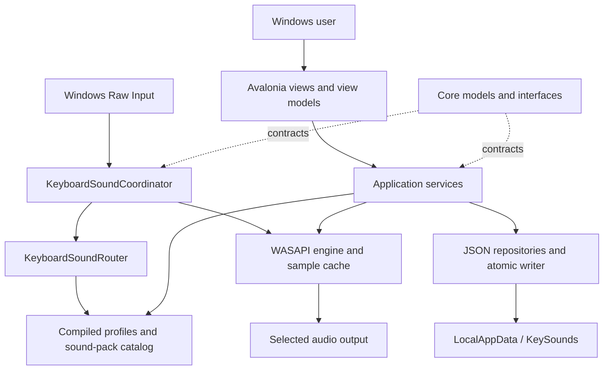
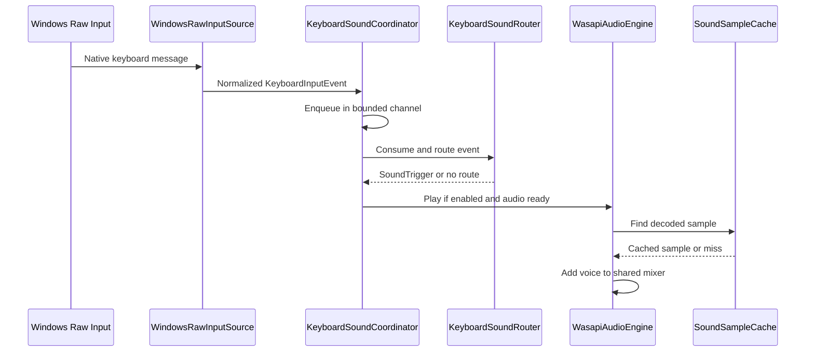

# KeySounds system design (SDD)

Status: current implementation documentation, reviewed 10 October 2026.

## Purpose and constraints

KeySounds adds configurable sound feedback to keyboard input on Windows. Users manage local sound packs and profiles, route events by key group or override, select audio output, and optionally assign profiles to individual keyboards. The application is free and open source under MIT.

The current design prioritizes local processing, responsive input handling, reusable audio samples, and testable native integrations. Windows Raw Input, keyboard metadata, the registry startup entry, and WASAPI make Windows the supported runtime platform. Avalonia's platform support does not imply that these integrations work on other operating systems.

## Physical structure and responsibilities

The repository has **one application project**, `KeySounds.csproj`, and **one test project**, `KeySounds.Tests/KeySounds.Tests.csproj`, both targeting `net10.0`. The test project references the application; the application excludes test source from compilation. There is no solution file or collection of separately compiled architecture projects.

| Area | Implemented responsibility |
| --- | --- |
| Root views and `ViewModels/` | Avalonia presentation, commands, status, and page state. |
| `App.axaml.cs` / `Program.cs` | Manual dependency composition, application startup, single-instance handling, tray/window lifecycle, shutdown, and diagnostics CLI. |
| `Core/` | Domain models and boundary contracts for keyboard events, profiles, settings, packs, sound triggers, and audio. |
| `Application/` | Profile compilation/editing, routing, pack workflows, device selection, settings/migrations, diagnostics, and orchestration. Some UI picker adapters also live here. |
| `Platform/Windows/Input/` | Native Raw Input calls, parsing, message-window lifecycle, and keyboard metadata. |
| `Audio/` | NAudio decoding, decoded-sample caching, mixing, and WASAPI playback. |
| `Infrastructure/Persistence/` | Local storage paths, JSON repositories, and atomic writes. |
| `KeySounds.Tests/` | xUnit v3 tests, including native/parser behavior, routing, persistence, migrations, audio selection, and pack workflows. |

Folder and namespace boundaries are organizational within one assembly. They are not enforced by project references. Application services use constructor injection, and native/audio/file-picker boundaries have replaceable interfaces for tests.



## Runtime flows

### Startup and shutdown

`Program.Main` handles `--diagnostics <output-path>` before normal UI startup. Otherwise, `SingleInstanceCoordinator` admits a primary instance and signals it when another launch requests activation. The primary instance starts Avalonia; `App` composes services and view models, creates the main window and tray menu, and starts asynchronous initialization.

Settings, profiles, pack catalog, migrations, keyboard assignments, and audio configuration are coordinated by the application services. Normal startup uses the persisted output preference and falls back where the device-selection implementation permits it. The built-in click asset provides the initial fallback sound pack.

The tray supports opening the window, enabling/disabling sounds, opening packs, exporting diagnostics, and exiting. Closing the window normally hides it. Explicit exit cancels startup/background work and asynchronously disposes services, input, audio, cache, catalog, and view models before terminating the desktop lifetime.

### Keyboard event to sound



The coordinator's channel holds 256 events and drops the oldest event under overload. This bounds queued work; it does not guarantee every keyboard event becomes sound. The native callback requests keyboard identity resolution and enqueues work rather than decoding audio or performing persistence. Interactive key capture intercepts the next key-down for profile editing.

The router selects a keyboard-assigned compiled profile when available, otherwise the active profile. It tracks press/repeat state by device and key, resolves overrides/groups and key-down/key-up behavior, applies repeat policy and variations, and returns a `SoundTrigger`. Disabled playback and unavailable audio are counted as drops. Counters are aggregate runtime status, not stored key histories.

The engine uses shared-mode WASAPI through NAudio, a mixer, and cached decoded samples. Playback does not decode files on each event. The current engine caps active voices at 32, rejects playback while it is not running, and records suppression during output switching. Pitch and gain are bounded by the implementation.

### Profiles and sound packs

Profile editing and validation are separate from compilation and active routing. JSON repositories persist editable models; compiled snapshots support runtime routing. Keyboard-specific assignments use stable local device metadata when it is available and fall back to the active profile when resolution cannot supply an assignment.

Sound-pack services handle folder selection, manifest validation, cataloguing, preview, imports, ID conflicts, profile dependencies, draft creation/editing, and managed-storage cleanup. A pack's manifest references local sample files. Imports and profile operations validate IDs and paths rather than treating arbitrary paths as trusted. See the [sound-pack format](../../docs/soundpack-format.md) for the public manifest contract.

### Audio-device switching and degraded operation

Device selection distinguishes the configured preference from the effective runtime output. The selectable engine serializes switches, publishes status, and reconciles device changes. A missing specific device can fall back to the system default while retaining the configured preference. If no usable output exists, status reports unavailability and new triggers are dropped. Switching and shutdown share explicit lifecycle coordination; input/audio failures are surfaced in the UI.

## Contracts and data

| Contract | Role |
| --- | --- |
| `IKeyboardInputSource` / `KeyboardInputEvent` | Start/stop input and expose normalized keyboard/device/failure events. |
| `IAudioEngine` / `ISelectableAudioEngine` | Initialize, play triggers, select output, expose status, and shut down. |
| `SoundTrigger` | Resolved sound identity plus gain and pitch for playback. |
| Profile and settings repositories | Load/save local editable models through JSON and migration services. |
| Sample decoder/cache and device-service interfaces | Replace disk decoding and hardware behavior with controlled test doubles. |

There is no hosted API, remote database, authentication service, cloud synchronization, or upload service. Public interchange consists of local profile/pack data and diagnostics, not a network protocol. This repository cleanup changes no application API or data schema.

Default storage is `%LocalAppData%\KeySounds`:

```text
KeySounds/
  settings.json
  profiles/
  soundpacks/
  diagnostics/       exported local diagnostic reports
  reports/           optional local error reports
```

`AtomicFileWriter` serializes JSON to a temporary file, flushes it, deserializes it to validate the result, and moves or replaces the destination, retaining a backup on replacement. Its write gate serializes writes through that writer instance. These are file-level writes, not transactions spanning an entire profile/pack workflow. Migration services handle compatibility; upgrade testing must retain real app-data backups.

## Privacy, failures, and observability

Keyboard events are processed locally and transiently. Typed text and key sequences are not persisted or transmitted. Persisted keyboard assignments can include a stable local identity; diagnostics exclude identity strings and raw HID paths by design. Normal runtime storage lives outside the source repository.

Diagnostics expose aggregate state and metadata. Optional error reports contain category, exception type, timestamp, operation, and a shortened message. The current error-message sanitizer replaces the local username and truncates to 512 characters; it is not a general detector of arbitrary secrets or paths. Review exports before publishing them. See [privacy](../../docs/privacy.md).

Status updates report input/audio availability, routing counts, cache behavior, and failures. Existing tests use fakes to exercise invalid manifests, unsafe paths, missing samples/devices, migration, lifecycle, and persistence behavior. Hardware, tray, startup registration, and real latency require manual Windows checks; automated success does not establish those measurements.

## Build, release, and verification

Use the commands in the [README](../../README.md) to restore, build the test project in Release, run xUnit tests, and launch the app. Dependencies are Avalonia 12, NAudio 2.2.1, and xUnit v3; exact package versions are declared in the project files.

GitHub Actions uses Windows runners and the .NET 10 SDK. Pull requests and pushes to `main` run restore/build/test and retain TRX reports. Version-tag pushes (`v*`) run the same checks, then publish a self-contained `win-x64` folder, ZIP it, and attach the ZIP and SHA-256 checksum to a GitHub Release. Only the release job has repository contents write permission. Official action references are pinned to commit hashes.

`scripts/publish-portable.ps1` validates its deletion target, fails on publish errors, verifies the executable and absence of test assemblies, and includes the MIT license and privacy notice. Build output and logs are ignored and excluded from Git history. See [packaging](../../docs/packaging.md) and the [release checklist](../../docs/release-checklist.md).

## Trade-offs and remaining work

- One application assembly keeps delivery simple; separate projects could enforce dependency direction if future complexity warrants it. The earlier multi-project proposal is historical, not the current layout.
- Windows-specific adapters provide Raw Input and WASAPI integration. Cross-platform support needs new implementations and platform verification.
- Bounded event buffering, voice limits, and caches bound work and favor responsiveness, with dropped sounds under overload.
- Portable folder publishing preserves native/dependency assets. An installer, code signing, and validated single-file distribution remain future work.
- Runtime performance and device compatibility require measurements on target machines. Recorded historical measurements are not guarantees for a new build.

The [repository audit](../../docs/repository-audit.md) records this readiness pass. Earlier proposals and phase reviews are indexed separately in [docs](../../docs/README.md).
